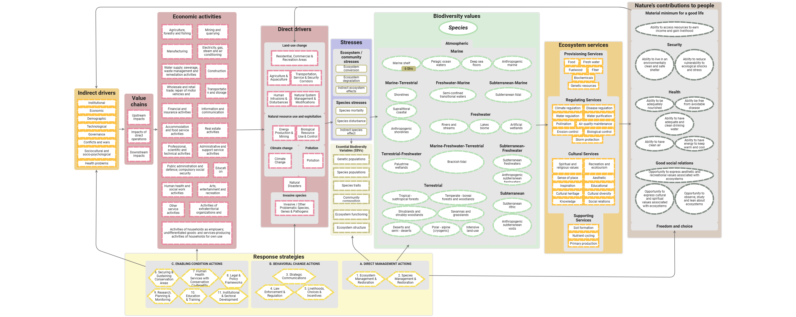

::: callout-caution
This chapter is currently under review and is subject to change.
:::

# Contribution Guide



::: callout-tip
Information sessions were held to share the information contained in this document.
You can find the recordings on the CSBQ's YouTube channel.

- [Session d'information en français](https://www.youtube.com/watch?v=Wcmnm1WbO2s)
- [Info session recording in English](https://www.youtube.com/watch?v=c9vDBAY7wBo)
:::

Thank you for taking the time to review this guide!
This guide will ensure that the evaluation (@nte-eval) has a consistent format, allows users to adapt it to their needs, and ensures its reproducibility for future updates.

The main objective of the assessment is to synthesize existing knowledge and data (a subnational [IPBES-style assessment](https://www.ipbes.net/global-assessment)).
The synthesis will enable us to make executive summaries and other decision-making tools in order to make the synthetic knowledge accessible to the deliberately braod category of Quebec’s decision makers .

::: {#nte-eval .callout-note}
### Glossary for this document

**Assessment**: The Quebec Assessment of Biodiversity and Nature’s Contributions to People.
This includes the e-book, the executive summary, as well as all associated source code, data, and synthesis work.

**Section**: One of the main themes of the assessment:

1.  Preamble
2.  Rationale and Approach
3.  Overview of Biodiversity
4.  Drivers of Change
5.  Nature’s Contributions to People (NCP)
6.  Future Opportunities
7.  Strategies (formerly Solutions)
8.  Conclusions and Recommendations

**Chapter**: a section of the assessment that could be published independently of the others.
See [@sec-TDM] for the table of contents, including the preliminary list of chapters.
:::

## Types of Contributions

### Corrections and Suggestions

Everyone is invited to submit suggestions and requests for corrections.
You are invited to comment on any chapter or appendix of this e-book, including the table of contents [@sec-TDM], the scoping document [@sec-scoping], the preliminary module on land-use changes (expected draft for September 2026), or even this guide itself.
Your contribution will be acknowledged in the acknowledgments section.

When a chapter is open for review, this type of contribution is especially encouraged.

If you have a GitHub account, you can create an “Issue” (report a problem) or a “pull request” (suggest a change) in [the project repository](https://github.com/QCBS/rQEB).
You can also submit feedback by emailing [rapport\@qcbs.ca](mailto:rapport@qcbs.ca).

### Lead Chapter Development (Co-author)

This role is well-suited for students, but is also open to anyone with scientific expertise and an interest in one of the chapters listed in the table of contents : [@sec-TDM].
There are many possible tasks associated with this role; here are a few examples:

- Reviewing scientific and gray literature
- Making data that is difficult to reuse accessible
- Drafting summary text following an established framework
- Analyzing openly available data

For more details regarding the writing process, see @sec-anatomie-chapitre and @sec-TDM.
Your contribution will be acknowledged by adding your name to the list of authors for the chapters to which you contributed (see @sec-ordre-auteurs for the convention on author order).

QCBS student members may apply for two grants to support their involvement in the project:

- [To contribute to the analysis and drafting of the evaluation](https://qcbs.ca/champion-grants-assess-biodiversity-and-natures-contribution-to-people-in-quebec/)
- [To make data available and accessible](https://qcbs.ca/champion-grants-to-rescue-quebecs-biodiversity-data/)

You will be invited to participate in working groups (see dates in the next section).

To express your interest, please fill out [this form](https://forms.cloud.microsoft/r/wGdRbvhqAz) or email [rapport\@qcbs.ca](mailto:rapport@qcbs.ca).

### Supervise Chapter Development (co-author)

This role is suited for individuals with expertise related to at least one of the chapters in the table of contents: [@sec-TDM].
Co-researchers from [the Quebec Center for Biodiversity Science](https://qcbs.ca/fr/) are particularly encouraged to participate.

You will be expected to help recruit experts and other potential contributors, plan the content of a chapter, guide the writers and analysts, and review both the final and interim drafts.
Your contribution will be acknowledged by including your name in the list of co-authors for each of the chapters to which you have contributed (see @sec-ordre-auteurs for the convention regarding author order).

Ideally, you should be available for the working group meeting dates.
Here are the dates for the 2026–2027 academic year:

- November 5–6, 2026
- February 4–5, 2027
- April 29–30, 2027

The location of the meetings has yet to be determined.

To express your interest, please fill out [this form](https://forms.cloud.microsoft/r/wGdRbvhqAz) or email [rapport\@qcbs.ca](mailto:rapport@qcbs.ca).

### Revise

This role is open to all stakeholders in the biodiversity sector in Quebec and Canada.
Your task involves evaluating the relevance of the findings, the quality of the methodology, and the credibility of the data sources.
You will be required to complete an evaluation form and provide constructive feedback within a set timeframe.

Your contribution will be acknowledged in the acknowledgments section.

To express your interest, please fill out [this form](https://forms.cloud.microsoft/r/wGdRbvhqAz) or email [rapport\@qcbs.ca](mailto:rapport@qcbs.ca).

## Suggested Timeline

This timeline is a suggestion.
The modular format of the assessment allows the publication of chapters as they are ready, and the possibility of future updates.

Some chapters will be started later, but the steps will remain the same.

**September–October 2026**: Team formation and planning of chapter contents (sub-themes).

**➝ November 5, 2026**: Meeting in Bromont between chapter supervisors to align chapter content.

**November 2026 through February 2027**

- Team meetings to assign tasks
- Identifying Obstacles
- First draft

**➝ February 4–5, 2027**: Troubleshooting and problem-solving meeting.

**February–April 2027**: Writing and revisions.

**➝ April 29–30, 2027**: Progress review meeting.

**April–May 2027**: Finalization of the internal review.

**➝ May 31, 2027**: Suggested deadline for completion of the internal review.

**Summer 2027**: External review.

**Fall 2027**: Final revisions and publication with a DOI.

**After 2027**: Regular updates (versioned DOI).

## Development of a chapter {#sec-anatomie-chapitre}

### Make a plan

At a minimum, the plan should include:

- Objectives, or questions the chapter will attempt to answer
- The sections and subsections of the chapter
- People who can contribute to each of the (sub)sections
- Some relevant synthetic sources

### Write an Introduction

::: callout-note
A working template will be made available by December 2026
:::

Very briefly, explain why this topic is relevant.

Summarize the overview information already available at the modal level (overall findings).
Generally, this type of information can be quickly identified through the IPBES Global Assessment [@ipbes2019] or more recent and topical meta-analyses and literature reviews.
This synthesis may include Indigenous knowledge and perspectives as well as those of Western science.

If applicable, identify and justify the use of one or more key indicators or variables that could be used to measure temporal changes and spatial variations related to the topic and that will be analyzed later.

Create links to other chapters in the book that interact with or overlap with the theme of your chapter.

Provide the Quebec context that frames the topic.
For example, Quebec laws or stakeholders with a strong and direct connection to the topic.

### Literature Review

For most chapters, a literature review approach is recommended.

#### Identify the sources

Identify relevant sources pertaining to the territory of Quebec; complete coverage of the territory is not required.
Pay particular attention to identifying sources relevant to Indigenous roles, perspectives, or knowledge.

Tools available to you:

- QCBS Network. Ask experts for relevant references and insights.
- A database containing primary research articles and gray literature sources, along with an artificial intelligence tool for searching the database, created by the QCBS (link coming soon). In the meantime, please contact Amine to conduct searches ([data\@qcbs.ca](mailto:data@qcbs.ca)).
- Search tools (e.g., Google Scholar), artificial intelligence tools (e.g., [AstaAI](Asta.allen.ai)), or reaching out to your network and the QCBS’s network to obtain additional sources of gray literature to add to our database. Record the methodological details of your research, such as the search engines used, the keywords used, the dates of the searches, the people contacted, and the criteria used to include or exclude a source. You may use an appendix if necessary.

When discussing drivers of change, be sure to consider studies that examine the underlying causes of the direct drivers.

#### Evaluate Sources

Second, evaluate the information provided by each source in terms of space, time, and methodology.

For the sections on drivers of change and strategies, try to assess the impacts of the driver or strategy in question on the various aspects of biodiversity, using the terminology of essential biodiversity variables ([*EBVs*](https://geobon.org/ebvs/what-are-ebvs); @kissling2018) or on nature’s contributions to people.

For the section on nature’s contributions to people (NCPs), try to assess the influence of biodiversity (EBV terminology) on the contribution in question.
Classify the measured NCPs according to the classification of Essential Ecosystem Service Variables ([*EESV*](https://geobon.org/ebvs/ecosystem-services-working-group/what-are-eesvs/); @balvanera2022).

Pay particular attention to sources that include a temporal component to understand how variables or indicators change over time, and take note of any predictions.

Briefly describe the methodological approach used by the various sources.

Take note of any gaps, whether in terms of spatial or temporal coverage, or reliability.

You can organize the sources into a table to make it easier to evaluate and extract findings.

### Analysis of Available Data

::: callout-warning
Before diving into an analysis, discuss it with a representative from [Biodiversité Québec](https://biodiversite-quebec.ca/fr/contactez_nous) to avoid duplicating analyses already in progress.
:::

If one or more data sources are available and cover a large geographic area, it may be appropriate to conduct an analysis tailored to Quebec.

Start by describing each data source, specifying its methodology, including its resolution and spatial and temporal scope.

Next, use the data to answer the following questions:

- What is the current status, or at least the most up-to-date estimate (specifying the date of the estimate), of the variable or indicator?
- How has the variable or indicator changed over the past 5, 10, 20, 50, or 100 years (depending on data availability)?
- If any predictions have been made, what are they, and what are they based on?

For each answer to the questions above, specify:

- Summary statistics (e.g., mean) for Quebec, southern Quebec (south of the 49th parallel), and the various administrative regions of Quebec.
- If multiple data sources are available, the level of agreement among the different data sources.

### Findings

Regardless of the approach, provide a few key messages that summarize the status, changes, spatial variability, and level of available information related to the main themes.
These findings will be incorporated when drafting the executive summaries.

Compare the situation in Quebec with the overall situation, as summarized in the introduction.

Evaluate each finding based on the quantity, quality, and level of consistency among the sources related to that finding (@tbl-confidence).

::: {#tbl-conf}
Classification of confidence levels for findings, based on [the IPBES author’s guide](https://www.ipbes.net/guide-production-assessments).

|  |  |  |
|----|----|----|
| **Evidence / Agreement** | **High Agreement** | **Low agreement** |
| **Abundant, high-quality data** | Well **established**: Robust data and clear scientific consensus. | Unresolved: Many studies exist, but their results are contradictory. |
| **Limited or low-quality data** | **Established but incomplete**: General agreement among experts, but field data are lacking. | **Inconclusive**: Very little data and no consensus within the scientific community |
:::

## Principles and Frameworks to Follow

### Use of Knowledge and Data

::: callout-caution
The best way to implement these principles is still under discussion within the Evaluation Executive Committee and will undergo an external review process.
:::

Integrating the CARE, PCAP®, and FAIR principles maximizes the potential utility of the evaluation by making data accessible while respecting Indigenous communities’ data governance (see @imp-ind-data).

Note that you may need to make trade-offs to reconcile FAIR principles with CARE or PCAP® [@gudde2026].
If so, be sure to take an ethical and informed stance by explicitly justifying your choices.

::: {#imp-ind-data .callout-important}
##### Biodiversity data is Indigenous data

Indigenous data encompasses both data produced by Indigenous peoples—such as traditional and local knowledge—and data produced by governments and other institutions about Indigenous peoples, their territories, and the living beings found there [@carroll2020; @rainie2018; @FNIGC2020].
Because most of Quebec is part of the ancestral territory of various Indigenous peoples [@nativeland2024], the vast majority of data and knowledge related to biodiversity in Quebec can be classified as Indigenous data.

The principles of Indigenous data therefore apply to the use of the vast majority of data concerning biodiversity in Quebec.
:::

#### CARE: collective benefit, oversight authority, accountability, ethics

The CARE principles stipulate that Indigenous data (see @imp-ind-data) must be used for the collective benefit, remain under the authority of the communities concerned, be used responsibly, and adhere to Indigenous ethical principles [@carroll2020].
In the context of the assessment, this involves using [Local Context notices](https://localcontexts.org/notices/about-the-notices/) to indicate the presence of Indigenous data and committing to collaboration with Indigenous communities [@liggins2021; @carroll2021].
For example, the “[BC Notice](https://localcontexts.org/notice/bc-notice/)” is used to flag data generated from biodiversity.
However, the CARE principles are not limited to Local Context, and you are responsible for understanding and keeping these principles in mind to ensure that your use of the data complies with them.

#### PCAP®: Ownership, Control, Access, Location

The CARE principles are applicable internationally but direct users toward more local governance systems.
The PCAP® principles were created by Canadian First Nations for Indigenous data from Canadian First Nations (this does not include Inuit or Métis data).

The goal of the PCAP® principles is to ensure explicit governance of First Nations communities’ data by First Nations communities [@FNIGC_PCAP].
Therefore, when you wish to use Indigenous knowledge, keep in mind that it belongs to the communities concerned and that the storage, interpretation, use, and sharing of the data must remain under the governance of the communities.
This type of Indigenous data may therefore require approvals from the communities concerned.

PCAP® is a registered trademark of the First Nations Information Governance Centre (FNIGC).

#### FAIR: Findable, Accessible, Interoperable, and Reusable {#sec-FAIR}

The FAIR principles are designed to facilitate the reuse of data [@wilkinson2016].
In practical terms, this means that all derived products—including the data used to create tables and graphs—must be made available in an open and accessible format and accompanied by metadata.
By extension, all source code used to generate analyses must also be readable, portable, and shareable.
This principle is integrated into the proposed data analysis workflow [@sec-flux].
For each chapter, a metadata file must be available and formatted according to [the template provided by the Canadian Federated Research Data Repository](https://demo.frdr-dfdr.ca/docs/txt/README.txt).

### Vocabulary and System Analyses

Please make use of and contribute to the [dynamic glossary](https://docs.google.com/spreadsheets/d/1Q-cr7V4HtU418kz9OR_D7s_hWGWTEDYPjDlZ5o8RWAg/edit?usp=sharing) for our assessment.
This glossary is based on the Conservation Standards [@cmp2026].
This framework is compatible with the IPBES framework, which structures the table of contents [@díaz2015].

Writing this e-book is an exercise in synthesis, not in popularization.
An exercise in popularization will follow.

### Authoring and Authorship

#### Translation

All documents will be translated from French to English or vice versa.
Try to choose a common language so that all co-authors of a chapter can contribute as easily as possible.
If necessary, contact the project manager (Egor, [rapport\@qcbs.ca](mailto:rapport@qcbs.ca)) regarding your translation needs.

Don't forget to create versions of the charts and tables in both languages if you're able to!

##### English File Naming Convention

The names of files whose content is in English must end with`.en` (e.g., `MoteursChangement.en.qmd`) because French is considered the default language.

#### AI Policy {#sec-pol-IA}

Artificial intelligence (AI) must be used ethically and transparently, while ensuring the credibility of the assessment.
For more details, please consult the IPBES guide on AI [@IPBES-AI2026].

#### Reproducibility {#sec-repr}

One of the objectives of the assessment is to create a living document that can be updated as new data becomes available.
It is therefore essential that the methods be transparent and detailed, and that the analytical steps be automated to enable updates.

#### Order of Co-Authors {#sec-ordre-auteurs}

The working group associated with each chapter will be responsible for agreeing on an order of authors.

You are encouraged to follow a rating system like the one proposed by @martinig2026.

## Format

### Prose

When writing, you have two options:

1.  Start with a Word or Google Docs file to facilitate collaboration. During the external review phase, Egor ([rapport\@qcbs.ca](mailto:rapport@qcbs.ca)) will export the document to Quarto format. After the export, the chapter will be updated in the document.
2.  Start right away with the Quarto format. This approach is especially recommended if you plan to perform data analysis.

#### Quarto

Use the Quarto format (`.qmd`) to write your text following [Markdown conventions](https://quarto.org/docs/authoring/markdown-basics.html) (this is very useful for later generating a website or a PDF).
To make writing with Quarto easier, use [RStudio](https://posit.co/products/open-source/rstudio)’s built-in visual editor, or install [the Quarto extension](https://open-vsx.org/extension/quarto/quarto) for [Visual Studio Code](https://code.visualstudio.com/) or [Positron](https://positron.posit.co/).

For chapters that include data analyses, Quarto’s strength lies in its ability to integrate code with prose, thereby improving the reproducibility of the analysis (@sec-repr).
Use code sections in the Quarto file to load the results of your intermediate analyses, extract variables of interest, and programmatically insert them into the code.

*Example*:

```` markdown
```{{r}}
df <- read.csv("Out/abondance_ours.csv")

min_annee = min(df$annee)
max_annee = max(df$annee)

pop_base = df[df$annee == min_annee, "population"]
pop_ajd  = df[df$annee == max_annee, "population"]

dim_pop_ours_prcnt <- -1*round(100*(pop_ajd - pop_base)/pop_base, 2)
```

La population des ours noir au Québec a diminué de `{{r}} dim_pop_ours_prcnt` % entre `{{r}} min_annee` et `{{r}} max_annee`.
````

*Result (note: this example is not based on real data)*:

> The black bear population in Quebec decreased by 5.6% between 1980 and 2022.

To speed up performance, avoid including complex calculations or generating charts directly within Quarto files.

### Charts and Dashboards

You will be presented with a palette of perceptually uniform colors.
This type of palette allows people with color blindness to perceive and distinguish colors.

For each graph, create a `.csv` file that contains the data shown in the graph in tabular form.

You can also use [Quarto with Shiny](https://quarto.org/docs/interactive/shiny/) to create dashboards that allow for the exploration of more complex data.
These dashboards will be included in an appendix to the e-book.
Please contact Egor ([rapport\@qcbs.ca](mailto:rapport@qcbs.ca)) before creating a dashboard.

### Diagrams for Theories of Change

When we are ready to create diagrams to represent theories of change [@cmp2026] we will subscribe to [Miradi conservation software](https://www.miradishare.org/ux/home) to make it easier to create these diagrams in accordance with conservation standards.
Please email Egor ([rapport\@qcbs.ca](mailto:rapport@qcbs.ca)) as soon as you are ready to proceed to this step.

{#fig-conceptual-model .lightbox}

## Inspiration

If you're looking for inspiration based on what has already been done elsewhere:

- IPBES is the international panel responsible for synthesizing information related to biodiversity and the contributions of nature at the global level [@ipbes2019] and at the level of major global regions [@ipbes2018]. This can serve as a source of inspiration for framing an assessment of biodiversity and the contributions of nature to people.
- [Nova Scotia](https://storymaps.arcgis.com/collections/6b0e65ee9a984cd18548517a8b78a09f) and [Ontario](https://sobr.ca/) both have biodiversity assessments. Although the scopes of these assessments are more limited than the scope of the Quebec assessment (see @sec-scoping), the web-based formats of these reports may provide inspiration for our e-book.
- A detailed assessment of biodiversity in Switzerland was conducted as part of the effort to halt biodiversity loss in Europe by 2010 [@lachat2010]. This aligns well with our current situation under the Convention on Biological Diversity and Quebec’s Nature Plan 2030 [@MELCCFP2024PlanNature2030].
- In Colombia, an [annual assessment of the state of biodiversity](https://reporte.humboldt.org.co/biodiversidad) is presented in an interesting interactive format (in Spanish).

## Simplified Workflow {#sec-flux}

To collaborate easily, you can do so in a shared Drive (this approach requires a Google account).
Send your Google email address to Egor ([rapport\@qcbs.ca](mailto:rapport@qcbs.ca)) to get editing permissions.

To access the shared folder directly from your computer:

1.  Install[Google Drive on your computer](https://workspace.google.com/intl/en_ca/products/drive/#download)
2.  Open the[shared Drive](https://drive.google.com/drive/folders/1tM2c5sOOavlmsjOaHHuwWQJcHC94-x-x?usp=sharing).
3.  eval_qc_biodiv_ncp \> Organize \> Add a Shortcut \> All Locations \> My Drive \> Add

If one does not already exist, you can create a working folder for your chapter: \``livre_source > Px_[nom_de_partie] > XX_[nom_du_chapitre]`\`.
Where`PX`corresponds to the part number, and \`XX\` to the chapter number.

Be sure to keep all source documents so you can reproduce your documents.
This includes, but is not limited to:

- Data (or data sources, if large)
- Code
- Figures
- Reference Library
- List of Search Terms

## Workflow for Data Analysis

This workflow is useful if you plan to perform data analysis as part of your writing process.

### Useful Resources

- The "`git`" application and the collaborative tool "`GitHub`" for sharing updates directly to the repository that feeds content to the website.

- R for analyzing, visualizing, and communicating data

- Basics of Quarto or RMarkdown

The QCBS will hold GitHub and Quarto training sessions (dates to be announced; contact [rapport\@qcbs.ca](mailto:rapport@qcbs.ca) to express your interest).

### Ensure the reproducibility of results and the portability of code

Use the software`git`to “clone” the assessment repository (folder).
Save your progress using “commits” and submit a “pull request” to request review of your changes (user guide coming soon).
Avoid adding large files such as renderings from`.qmd`or databases (see @sec-data-management) to your "commits."

Avoid any manual data manipulation or declaration.
All components of the assessment should be reproducible using data available online and the source code.
If you’re having trouble completing a task in a reproducible manner, feel free to ask for help at ([rapport\@qcbs.ca](mailto:rapport@qcbs.ca)).

### Managing Data {#sec-data-management}

::: callout-note
One of the goals of the assessment is to make data accessible.
Furthermore, storing data directly in theproject’s`git`repositoryallows for better code reproducibility in the event that an external service is temporarily unavailable.
However, having a repository containing a large volume of data hinders collaboration.
:::

When you're working, you can save the large datasets you're working with on your computer, but only add the summary data and graphs you generate to the Git repository.
Don't forget to also include the code for downloading the data to ensure the code is reproducible.

| Refer to external resource    | Add a file to the Git repository  |
|-------------------------------|-----------------------------------|
| Mapping resource              | Metadata file                     |
| Database                      | Intermediate products (summaries) |
| Other files larger than 10 MB | Generated figures                 |

Be sure to save the intermediate data from your analyses in the `.csv`, or another open and accessible format (@nte-format-ouvert) in the `Out/` subfolder of your chapter folder.
If you have large datasets that are intermediate products of your analysis, save them separately in a [Zenodo](https://zenodo.org/) or [FRDR](https://www.frdr-dfdr.ca/repo/) repository.
Be sure to also include a metadata file to accompany the data, following [the template provided by the Canadian Federated Research Data Repository](https://demo.frdr-dfdr.ca/docs/txt/README.txt).

::: {#nte-format-ouvert .callout-note}
#### Open and Accessible Formats

These are file formats whose specifications are publicly available and that can be read, shared, and reused by a wide variety of software.
This enables long-term accessibility, interoperability, and reuse of the data (see the FAIR principles @sec-FAIR).

Examples of open formats: CSV, JSON, YAML, GeoJSON, HTML, PNG, SVG, PDF

Examples of proprietary or less accessible formats: Excel, Word, SPSS, Oracle database
:::

### Produce and document the code

Create functions that can be reused to reproduce similar analyses instead of copying and pasting the same code in multiple places.

Save your (interim) results in the subfolder named `Out` within the folder for the relevant chapter.

:::: panel-tabset
## R

Follow the [Tidyverse style guide](https://style.tidyverse.org/) to format your code in a readable and consistent manner.

Document your functions according to [Roxygen2 conventions](https://roxygen2.r-lib.org/articles/rd-functions.html).
Example:

``` r
#' Map IPCC land use categories to AAFC land use codes  
#' (one-to-many) mapping 
#' @param type IPCC land use class 
#' @param summary_col_name if true, prepend AAFC land use code with "frac_",  
#' for compatiblity with zonal summary data file. 
#' @export 
get_aafc_classes <- function(...) {...}
```

Prefer using [`box::use`](https://github.com/klmr/box)or explicit references (e.g.,`dplyr::filter()`) instead of`library`,`require`, and`source`.
Here is an example of using box:

``` r
# On importe deux fonctions:
#   `get_aafc_classes` dans un dossier local (module) et 
#   `select` du package dplyr. 
# Note: le dossier 2_MoteursChangement requiert le guillmet 
#       parceque le dossier commence avec un chiffre.
box::use(`2_MoteursChangement`/R/land_use_aafc[get_aafc_classes],    dplyr[select] )  

# Alternative pour importer toutes les fonctions d'un module ou dun package:
box::use(`2_MoteursChangement`/R/land_use_aafc[...], dplyr[...] )  

# Vous pouvez maintenant consultez la documentation 
#  de la fonction `get_aafc_classes` avec box::help
box::help(get_aafc_classes)
```

::: callout-important
##### Working folder (R)

For R scripts, the working directory is the root of the Git repository (`rQEB`).
However, by default, for`.qmd`files, the working directory is the same as the one containing the`.qmd`file, even when you use a function defined in an R script.

Consequently, when you write functions that are included in an R script:

- The argument for a function you create should preferably be an object rather than a file path.

- If you need to access a file, use `here::here(chemin/du/fichier.csv)` to ensure the path is relative to the `rQEB` directory, regardless of the working directory.

Be sure to test the code within the context of the `.qmd` file.
:::

To ensure a consistent graphical style, `R/get_fig_style.R` contains a function `style_plot()` that must be added to your `ggplot2` objects and a function `style_patchwork()` that must be added to your `patchwork` objects (to create a figure with multiple plots).

If ggplot2 does not meet your needs, you may suggest an alternative approach, but please contact [rapport\@qcbs.ca](mailto:rapport@qcbs.ca) to discuss it before proceeding.

## Excel

If possible, avoid using Excel for your analyses.

If you insist on using Excel, be sure to explicitly document the sources of all data required for the analysis and the steps to export the analysis results.
::::

## Project Folder Structure

`rQEB`This folder contains all other folders and files relevant to the project.

- The numbered folders (e.g.,`1_ContexteApproche`or`4_NCP`) contain the files relevant to each chapter.
  As a contributor, you’ll spend most of your time working in these folders.

  - The file with the same name as the folder and the extension`.qmd`contains the text and describes the content that will be displayed for that chapter on the web book page.

  - The `R` foldercontains the R scripts used for data analysis and to generate graphs.

  - The `Out` foldercontains transformed or intermediate data.

  - The `Fig` foldercontains graphs exported in `.png` format.

  - The working group may choose to modify or enhance this structure to better meet the chapter’s needs.

- `R`contains R scripts that may be useful for developing all chapters.
  You can contribute to this directory as well, but be careful not to break functionality used elsewhere in the project if you modify existing functions.

- `.github/workflows/`contains`.yml`filesused to automate GitHub Actions for automatically building the web book from Quarto files.

- `dev`contains functions useful for translating content and deploying it to the web.

- `_quarto.yml`and`_quarto-web-book.yml`contain Quarto configurations.
  `_quarto-web-book.yml`contains the list of Quarto files that will make up the web book.

- The folders`Scoping`,`Notes`,`Comm`, and`Grants`contain files related to project planning and scoping, committee meeting notes, communications, and scholarships offered to QCBS students as part of the project.

- `rQEB.Rproj`specifies the working directory for R scripts (but not`.qmd`)

- `index.qmd`and`index.en.qmd`contain the content used to generate the homepage of the evaluation website.

- `references.bib`contains a reference library accessible by all chapters.

- `references.qmd`is a template for the chapter containing the list of references for the project.

- `README.md`A README file explaining the folder structure described here.
